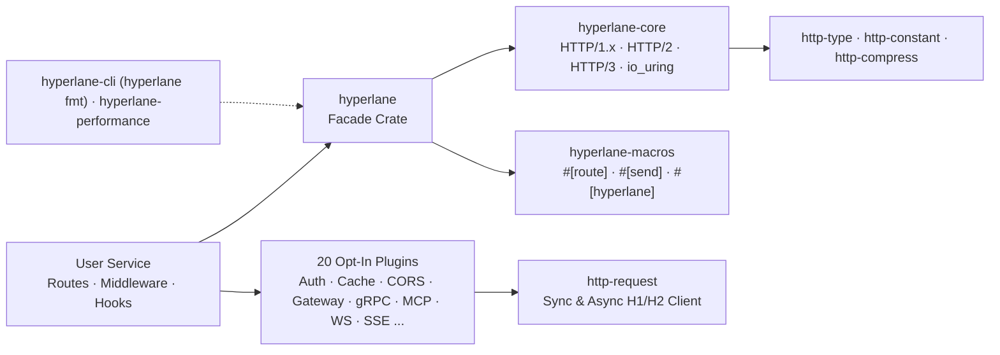

<div align="center">


# Hyperlane

**High-Performance Multi-Protocol Asynchronous Rust HTTP/1.x · HTTP/2 · HTTP/3 Web Framework & Plugin Ecosystem**

[][crate]
[][api]
[][ci]
[](https://www.rust-lang.org)
[](LICENSE)

[API Docs][api] · [Quick Start](#quick-start) · [Workspace Architecture](#workspace-architecture) · [Plugin Ecosystem](#opt-in-plugin-ecosystem) · [Benchmarks](#benchmarks) · [Agent Governance](./AGENTS.md)

</div>

---

## Overview

**Hyperlane** is a high-performance asynchronous Rust web framework built on Tokio. It serves HTTP/1.0, HTTP/1.1, HTTP/2 (`h2c`/`h2`), HTTP/3 (QUIC), WebSocket, Server-Sent Events (SSE), gRPC, JSON-RPC, and Model Context Protocol (MCP) workloads with explicit control over the request and response lifecycle, strict RFC 9110/9112 wire conformance, and 20 opt-in zero-overhead plugins.



---

## Quick Start

Create a binary crate targeting Rust edition 2024 and add `hyperlane`:

```sh
cargo new hello-hyperlane
cd hello-hyperlane
cargo add hyperlane
```

Replace `src/main.rs` with:

```rust
use hyperlane::{Context, Server, ServerConfig, ServerError, ServerHook, Status, Stream, tokio};

const ADDRESS: &str = "127.0.0.1:3000";
const ROOT_PATH: &str = "/";
const GREETING: &str = "Hello from Hyperlane!\n";

struct Hello;

impl ServerHook for Hello {
    async fn new(_: &mut Stream, _: &mut Context) -> Self {
        Self
    }

    #[hyperlane::send]
    async fn handle(self, stream: &mut Stream, ctx: &mut Context) -> Status {
        ctx.get_mut_response().set_body(GREETING);
        Status::Reject
    }
}

#[tokio::main]
async fn main() -> Result<(), Box<ServerError>> {
    let mut config: ServerConfig = ServerConfig::default();
    config.set_address(ADDRESS);

    let mut server: Server = Server::default();
    server.server_config(config).route::<Hello>(ROOT_PATH);

    let control = server.run().await?;
    println!("Listening on http://{ADDRESS}");
    control.wait().await;
    Ok(())
}
```

Run `cargo run` and query the endpoint:

```sh
curl -fsS http://127.0.0.1:3000/
```

`#[hyperlane::send]` serializes and flushes the response built by the hook; `Status::Reject` stops the remaining pipeline so downstream hooks do not send a second response.

---

## Capabilities

| Area                | Support                                                                                                                               |
| :------------------ | :------------------------------------------------------------------------------------------------------------------------------------ |
| **HTTP/1.x**        | HTTP/1.0 and HTTP/1.1 over TCP with optional TLS, keep-alive `Context` reset, and bounded chunked decoding                            |
| **HTTP/2**          | Cleartext (`h2c`) with prior knowledge or TLS with ALPN (`h2`)                                                                        |
| **HTTP/3**          | QUIC with TLS (`quinn` + `h3`)                                                                                                        |
| **Routing & Hooks** | Synchronous radix routing (`{param:regex}` anchored), typed request/response middleware, and `ServerHook` lifecycle                   |
| **Realtime & RPC**  | WebSocket rooms, WHATWG SSE, raw TCP, gRPC over HTTP/2, JSON-RPC 2.0, and Streamable HTTP MCP                                         |
| **Tooling**         | `hyperlane fmt` (delegating to `crate-cli` Prettier-aligned formatting + Hyperlane attribute normalization) and CPU-pinned benchmarks |

Select the wire protocol per listener via [`ServerConfig`][config].

---

## Workspace Architecture

All 29 crates share a unified version in root `Cargo.toml` (Rust edition `2024`):

### Core, Wire & Tooling Crates (9)

| Crate                                              | Path           | Responsibility                                                                                                             |
| :------------------------------------------------- | :------------- | :------------------------------------------------------------------------------------------------------------------------- |
| [`hyperlane`][api]                                 | `.` (`src/`)   | Facade crate re-exporting `hyperlane-core` and `hyperlane-macros`                                                          |
| [`hyperlane-core`](./core/README.md)               | `core/`        | Multi-protocol async server (`HTTP/1.x`, `HTTP/2`, `HTTP/3`), router, `Context`, `ServerHook`, Linux `io_uring`            |
| [`hyperlane-macros`](./macros/README.md)           | `macros/`      | Procedural attribute macros (`#[route]`, `#[hyperlane]`, `#[send]`, `#[host]`, `#[referer]`, etc.)                         |
| [`http-type`](./type/README.md)                    | `type/`        | RFC 9110/9112 wire parsers/builders, `Request`, `Response`, `Stream`, `Cookie`, `MultipartFormData`, `WebSocket`, `Status` |
| [`http-constant`](./constant/README.md)            | `constant/`    | Canonical HTTP header, method, status, and symbol constants                                                                |
| [`http-compress`](./compress/README.md)            | `compress/`    | Bounded gzip, deflate, and brotli codecs (`MAX_DECOMPRESSED_BYTES = 64 MiB`) and `Accept-Encoding` negotiation             |
| [`http-request`](./request/README.md)              | `request/`     | Sync & async HTTP/1.1 + HTTP/2 client with pooling, TLS resumption, retries, multipart, and HTTP/SOCKS5 proxies            |
| [`hyperlane-cli`](./cli/README.md)                 | `cli/`         | Developer CLI (`hyperlane fmt` layered on `crate-cli`, `watch`, `new`, `template`)                                         |
| [`hyperlane-performance`](./performance/README.md) | `performance/` | Official CPU-pinned native & Docker loadgen and deterministic `alloc-count` benchmark harness                              |

### Opt-In Plugin Ecosystem (20)

Every plugin is opt-in and transparent (`Status::Continue`) when unconfigured (see [`plugin/README.md`](./plugin/README.md)):

| Plugin Crate                                                       | Path                   | Responsibility                                                                                         |
| :----------------------------------------------------------------- | :--------------------- | :----------------------------------------------------------------------------------------------------- |
| [`hyperlane-plugin-auth`](./plugin/auth/README.md)                 | `plugin/auth/`         | HS256 JWT (`kid` rotation), API key, HTTP Basic, RBAC `AuthPrincipal`, `AuthHook`                      |
| [`hyperlane-plugin-cache`](./plugin/cache/README.md)               | `plugin/cache/`        | 64-way sharded bounded cache, single-flight coalescing, `CacheRequestHook`/`CacheResponseHook`         |
| [`hyperlane-plugin-cors`](./plugin/cors/README.md)                 | `plugin/cors/`         | Precompiled zero-alloc CORS headers, origin policies, preflight `OPTIONS`, `Vary` merging              |
| [`hyperlane-plugin-gateway`](./plugin/gateway/README.md)           | `plugin/gateway/`      | Reverse proxy & API gateway over pooled `http-request` with balancing, circuit breaker, GCRA limiter   |
| [`hyperlane-plugin-grpc`](./plugin/grpc/README.md)                 | `plugin/grpc/`         | gRPC over HTTP/2 5-byte framing, bounded compression, status codes `0..=16`, `grpc-timeout`            |
| [`hyperlane-plugin-health`](./plugin/health/README.md)             | `plugin/health/`       | `/healthz`, `/livez`, `/readyz` concurrent async probes, snapshot TTL cache, lock-free drain flag      |
| [`hyperlane-plugin-logger`](./plugin/logger/README.md)             | `plugin/logger/`       | Non-blocking buffered console/file logger with Plain/JSON formats and CRLF/ANSI sanitization           |
| [`hyperlane-plugin-mcp`](./plugin/mcp/README.md)                   | `plugin/mcp/`          | Streamable HTTP Model Context Protocol server with session TTLs and `Origin` DNS-rebinding guard       |
| [`hyperlane-plugin-metrics`](./plugin/metrics/README.md)           | `plugin/metrics/`      | Lock-free atomic counters, gauges, latency histograms, and Prometheus OpenMetrics `/metrics` endpoint  |
| [`hyperlane-plugin-mq`](./plugin/mq/README.md)                     | `plugin/mq/`           | Async `MessageBroker` trait and 64-shard `InMemoryBroker` with consumer groups, TTL, retries, DLQ      |
| [`hyperlane-plugin-negotiate`](./plugin/negotiate/README.md)       | `plugin/negotiate/`    | `Accept-Encoding` compression and conditional `304 Not Modified` ETag middlewares                      |
| [`hyperlane-plugin-rate-limit`](./plugin/rate_limit/README.md)     | `plugin/rate_limit/`   | 64-way sharded lock-free atomic GCRA & fixed-window rate limiter with RFC `RateLimit-*` headers        |
| [`hyperlane-plugin-rpc`](./plugin/rpc/README.md)                   | `plugin/rpc/`          | JSON-RPC 2.0 `XxHash3_64` router with concurrent batch/notification dispatch and payload caps          |
| [`hyperlane-plugin-security`](./plugin/security/README.md)         | `plugin/security/`     | Prebuilt HSTS/CSP/COOP/COEP/CORP headers, stateless HMAC-SHA256 CSRF, host/URI/traversal guards        |
| [`hyperlane-plugin-session`](./plugin/session/README.md)           | `plugin/session/`      | 64-shard bounded session store, HMAC-SHA256 signed cookies, dirty-tracked zero-write reads             |
| [`hyperlane-plugin-shutdown`](./plugin/shutdown/README.md)         | `plugin/shutdown/`     | Graceful shutdown coordinator with `SIGINT`/`SIGTERM` arming, RAII drain guards, LIFO callbacks        |
| [`hyperlane-plugin-sse`](./plugin/sse/README.md)                   | `plugin/sse/`          | WHATWG SSE framing, CRLF sanitization, 64-way sharded topic pub/sub, `Last-Event-ID` replay            |
| [`hyperlane-plugin-static-files`](./plugin/static_files/README.md) | `plugin/static_files/` | Traversal-proof static server, MIME table, hot-file cache, `.br`/`.gz` sidecars, `Range` (`206`/`416`) |
| [`hyperlane-plugin-tracing`](./plugin/tracing/README.md)           | `plugin/tracing/`      | Lock-free 128-bit W3C Trace Context (`traceparent`/`tracestate`), `X-Request-Id`, `Server-Timing`      |
| [`hyperlane-plugin-websocket`](./plugin/websocket/README.md)       | `plugin/websocket/`    | Room-based WebSocket broadcast with lag recovery, lifecycle hooks, and opt-in `WebSocketPlugin`        |

---

## Protocol Notes

These notes describe the current checkout. For behavior of an installed version, see [release notes][releases] and [API documentation][api].

- **Conditional requests**: `Request::matches_if_none_match(current_etag)` performs allocation-free weak ETag comparison (including repeated headers, quoted tags with commas, and `*`). Callers control `304 Not Modified` / `412 Precondition Failed` status selection.
- **HTTP/1.1 request bodies**: `Transfer-Encoding: chunked` is decoded transparently with bounded body limits; chunk extensions and trailers are consumed.
- **Default request errors**: Unparseable or oversized requests emit an empty error response (closing HTTP/1.x connections or completing H2/H3 streams) unless overridden by request-error hooks.

---

## Benchmarks

The [performance workflow][perf] runs the CPU-pinned Docker harness against baseline and candidate revisions in the same measurement window across `h1`, `h1-tls`, `h2c`, `h2-tls`, `h3`, and deterministic `alloc-count`.

---

## Verification & Governance

Before pushing or opening a pull request, run the full local quality gate:

```sh
cargo run -p hyperlane-cli -- fmt
cargo run -p hyperlane-cli -- fmt
cargo run -p hyperlane-cli -- fmt --check
cargo fmt --all -- --check
cargo clippy --workspace --all-features --all-targets -- -D warnings
cargo test --workspace --all-features
cargo check --release --workspace --all-features
```

- Engineering standards, wire invariants, module boundaries, and documentation update triggers live in [`AGENTS.md`](./AGENTS.md).
- Project-specific agent workflows live in [`.agents/skills/hyperlane/SKILL.md`](./.agents/skills/hyperlane/SKILL.md).
- Production starter template: [`hyperlane-quick-start`][example].

## License

Hyperlane is distributed under the [MIT License](LICENSE).

[api]: https://docs.rs/hyperlane/latest/hyperlane/
[ci]: https://github.com/hyperlane-dev/hyperlane/actions/workflows/rust.yml
[config]: https://docs.rs/hyperlane/latest/hyperlane/struct.ServerConfig.html
[crate]: https://crates.io/crates/hyperlane
[example]: https://github.com/hyperlane-dev/hyperlane-quick-start
[issues]: https://github.com/hyperlane-dev/hyperlane/issues
[perf]: https://github.com/hyperlane-dev/hyperlane/actions/workflows/perf.yml
[releases]: https://github.com/hyperlane-dev/hyperlane/releases
